<div align="center">

# 📊 Data Visualization — Model Practical Lab Experiments

### M.E. CSE — IIT1 | Complete Lab Solutions with 20 Python Programs

[](https://python.org)
[](https://pandas.pydata.org)
[](https://matplotlib.org)
[](https://seaborn.pydata.org)
[](https://scikit-learn.org)
[](https://www.kaggle.com/code/arulmariaagnes/data-v)
[](LICENSE)

<p align="center">
<strong>10 Simple Programs</strong> for beginners + <strong>10 Advanced Programs</strong> for deep understanding<br>
Built on a realistic <strong>1,200-row synthetic student performance dataset</strong>
</p>

---

</div>

## 🎯 About This Repository

This repository contains complete, exam-ready solutions for the **Data Visualization
Model Practical Lab** (M.E. CSE — IIT1). Every one of the 10 lab questions is solved
**twice**: a *simple version* (80–120 lines, beginner-readable, commented line by line)
and an *advanced version* (150+ lines with statistical tests, diagnostics and richer
chart design).

Everything runs on one **synthetic dataset** of 1,200 CSE students × 20 columns,
generated by a reproducible script (NumPy seed 42) with realistic correlation
structure, deliberate outliers, and 25 automated validation checks. The data is
**100% fictional** — no real student records are used.

Each program prints a plain-English interpretation after drawing its charts, so you
can *explain* your outputs in the viva, not just produce them.

## 📑 Table of Contents

| # | Topic | Simple | Advanced |
|---|-------|--------|----------|
| 1 | Bar Chart, Histogram, Box Plot | ✅ `q01_bar_histogram_boxplot.py` | ✅ `q01_advanced_categorical_numerical.py` |
| 2 | Time-Series Line Chart | ✅ `q02_time_series_line_chart.py` | ✅ `q02_advanced_time_series.py` |
| 3 | Misleading Chart & Fix | ✅ `q03_misleading_chart_fix.py` | ✅ `q03_advanced_redesign.py` |
| 4 | Compare Graphical Encodings | ✅ `q04_encoding_comparison.py` | ✅ `q04_advanced_encoding.py` |
| 5 | Exploratory Data Analysis | ✅ `q05_eda_distributions.py` | ✅ `q05_advanced_eda.py` |
| 6 | Scatter, Pair Plot, Heatmap | ✅ `q06_scatter_pairplot_heatmap.py` | ✅ `q06_advanced_correlation.py` |
| 7 | Linear Regression | ✅ `q07_regression_line.py` | ✅ `q07_advanced_regression.py` |
| 8 | Rolling Average & Uncertainty | ✅ `q08_rolling_avg_uncertainty.py` | ✅ `q08_advanced_rolling_uncertainty.py` |
| 9 | PCA Visualization | ✅ `q09_pca_visualization.py` | ✅ `q09_advanced_pca.py` |
| 10 | t-SNE & UMAP | ✅ `q10_tsne_umap.py` | ✅ `q10_advanced_tsne_umap.py` |

## 🗂️ Project Structure

```
Data-Visualization-Model-Practical-Lab-Experiments-IIT1/
├── datasets/
│   ├── cse_student_performance_1200.csv   # 1200 × 20 (synthetic)
│   └── DATASET_README.md                  # full column documentation
├── scripts/
│   └── generate_dataset.py                # regenerates CSV + 25 validation checks
├── simple_version/                        # 10 beginner programs (+ legacy exp*.py)
│   └── q01 … q10 + README.md
├── full_version/                          # 10 advanced programs (+ legacy exp*.py)
│   └── q01 … q10 + README.md
├── kaggle/
│   ├── data_visualization_complete_lab.ipynb   # all 10 questions in one notebook
│   └── KAGGLE_INSTRUCTIONS.md
├── outputs/
│   ├── simple/    (23 PNG charts)
│   └── advanced/  (20+ PNG charts)
├── requirements.txt
├── .gitignore
├── README.md
└── LICENSE
```

## 📊 Dataset Details

| Property | Value |
|---|---|
| Rows × Columns | 1,200 × 20 |
| Departments | CSE (900), CSE-AI (200), CSE-DS (100) |
| Semesters | 2, 4, 6, 8 |
| Date range | 2025-01-06 → 2025-04-28 (weekly assessments) |
| Target variable | `final_exam_marks` (μ ≈ 57.9, σ ≈ 15.2) |
| Grades | O, A+, A, B+, B, C, F (Pass rate 87.9 %) |
| Key correlations | study↔marks **r=0.57**, attendance↔marks **r=0.48**, coding↔lab **r=0.56** |
| Outliers | 24 deliberate, documented outliers for EDA discussion |

> ⚠️ **SYNTHETIC DATA** — generated for teaching; not real student records.
> Full docs: [`datasets/DATASET_README.md`](datasets/DATASET_README.md)

## 🚀 Quick Start

```bash
git clone https://github.com/ArulAgnes/Data-Visualization-Model-Practical-Lab-Experiments-IIT1.git
cd Data-Visualization-Model-Practical-Lab-Experiments-IIT1
pip install -r requirements.txt

# regenerate the dataset (optional — the CSV is already committed)
python scripts/generate_dataset.py

# run any program (from the repository root)
python simple_version/q01_bar_histogram_boxplot.py
python full_version/q01_advanced_categorical_numerical.py
```

Every program saves its PNGs into `outputs/simple/` or `outputs/advanced/`
and prints an interpretation to the console. No `plt.show()` windows are opened
by default — uncomment the `# plt.show()` line if you want pop-ups locally.

## 📝 Lab Questions and Solutions

### Question 1 — Bar Chart, Histogram & Box Plot
- **Simple:** `simple_version/q01_bar_histogram_boxplot.py` — 3 basic charts per section
- **Advanced:** `full_version/q01_advanced_categorical_numerical.py` — grouped bars, overlaid histograms, gender box plots, group statistics
- **Key concepts:** `plt.bar`, `plt.hist`, `sns.boxplot`, value labels, legends

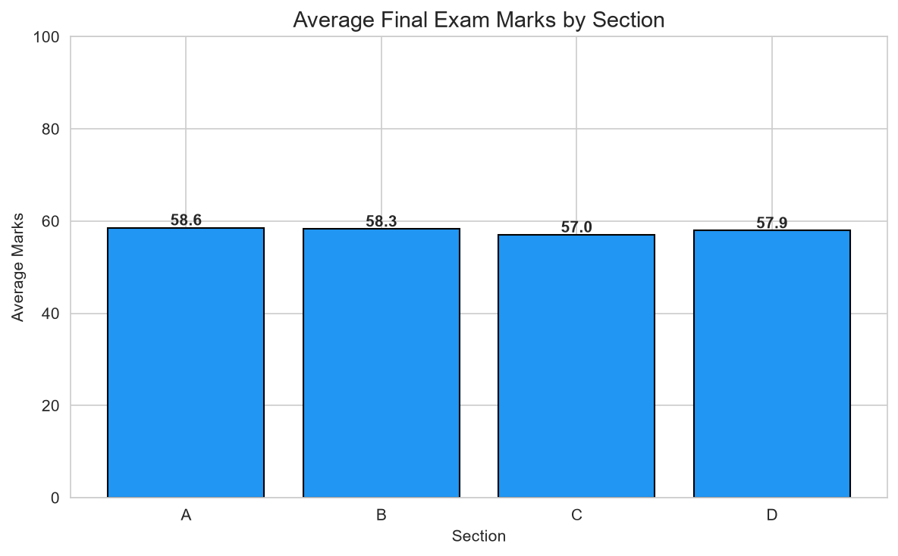
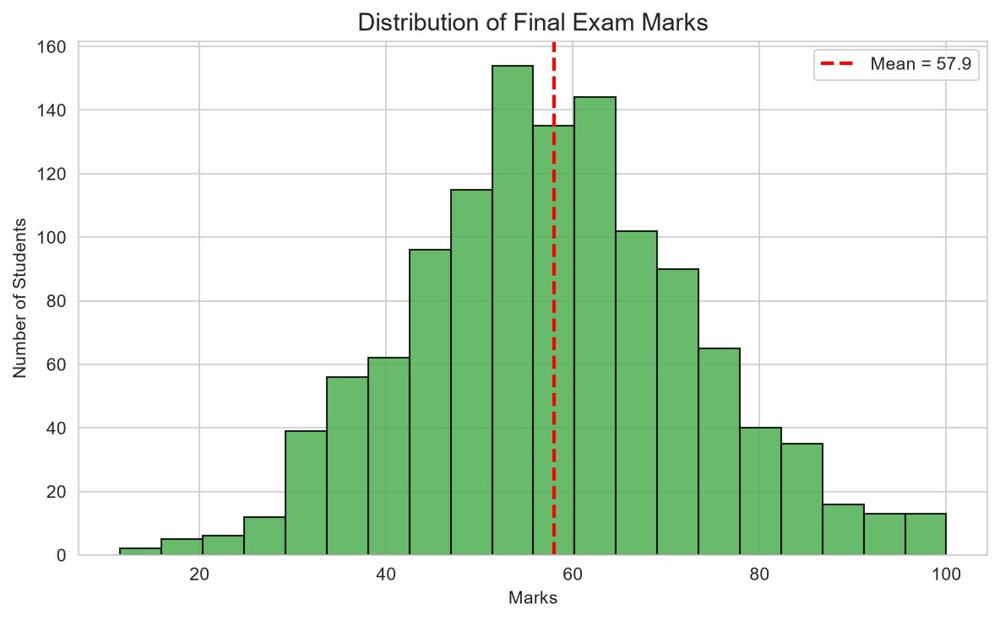

### Question 2 — Time-Series Line Chart
- **Simple:** `simple_version/q02_time_series_line_chart.py` — weekly assessment trend
- **Advanced:** `full_version/q02_advanced_time_series.py` — dual axes, trend line, seasonal boxes, peak/valley annotations
- **Key concepts:** `pd.to_datetime`, group-by-date, `plt.plot(..., marker='o')`

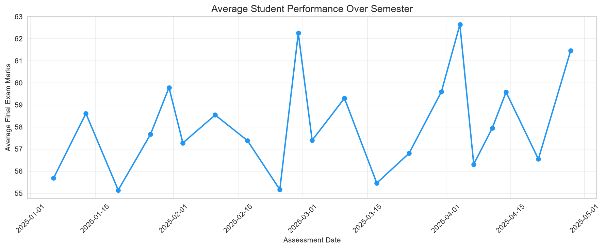

### Question 3 — Misleading Chart & Its Fix
- **Simple:** `simple_version/q03_misleading_chart_fix.py` — 4 issues, before/after
- **Advanced:** `full_version/q03_advanced_redesign.py` — 6 issues, report card, perception theory
- **Key concepts:** zero-based axes, colour accessibility, no chartjunk

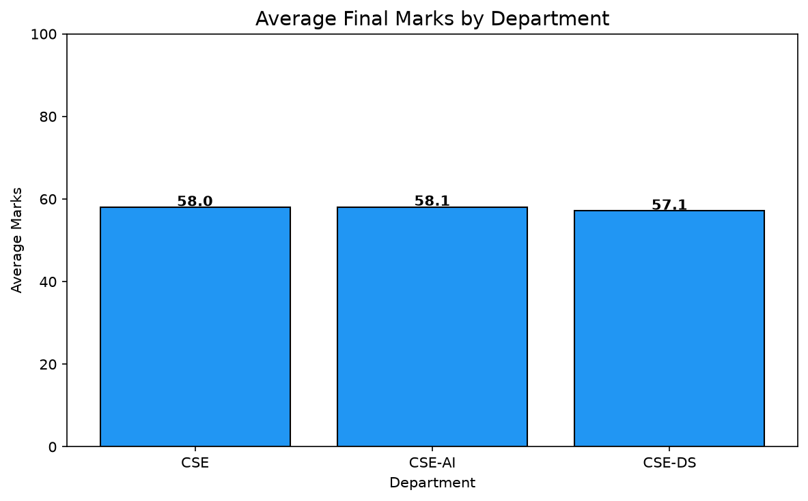

### Question 4 — Compare Graphical Encodings
- **Simple:** `simple_version/q04_encoding_comparison.py` — bars vs bubbles + redesign
- **Advanced:** `full_version/q04_advanced_encoding.py` — 3 encodings, Cleveland–McGill ranking
- **Key concepts:** position/length beats area beats colour


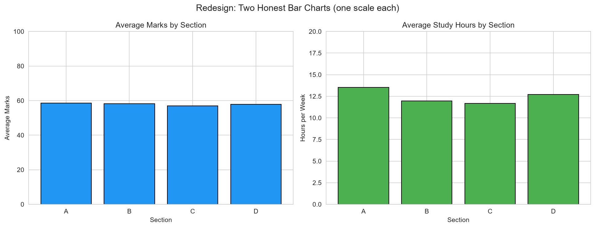

### Question 5 — Exploratory Data Analysis
- **Simple:** `simple_version/q05_eda_distributions.py` — histograms, boxes, KDE, violins
- **Advanced:** `full_version/q05_advanced_eda.py` — QQ plots, skew/kurtosis, IQR vs z-score outliers
- **Key concepts:** skewness, quartiles, IQR = Q3 − Q1, outlier fences

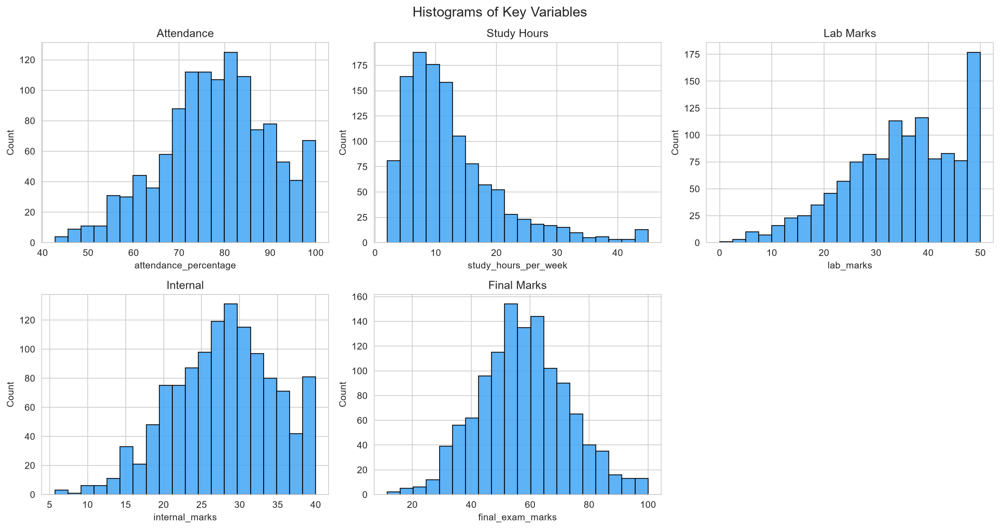
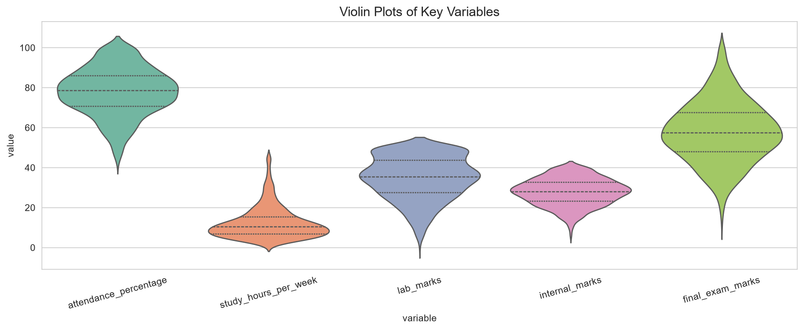

### Question 6 — Scatter, Pair Plot & Heatmap
- **Simple:** `simple_version/q06_scatter_pairplot_heatmap.py`
- **Advanced:** `full_version/q06_advanced_correlation.py` — Pearson p-values, strength labels, annotated outliers
- **Key concepts:** `sns.heatmap(annot=True)`, correlation matrix, **correlation ≠ causation**

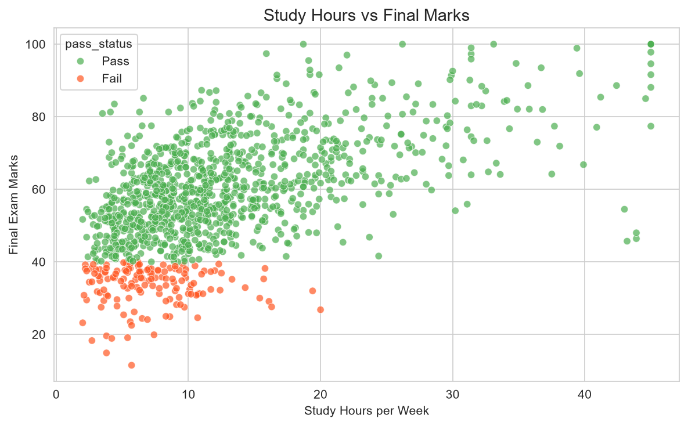
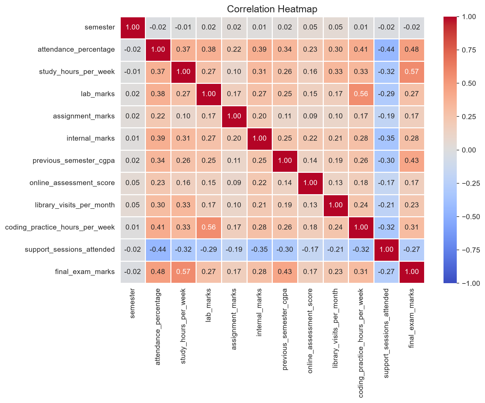

### Question 7 — Linear Regression
- **Simple:** `simple_version/q07_regression_line.py` — fit line, R², residuals
- **Advanced:** `full_version/q07_advanced_regression.py` — statsmodels OLS, 2×2 diagnostics, Cook's distance, CI vs PI
- **Key concepts:** `LinearRegression().fit(X, y)`, slope, intercept, R²

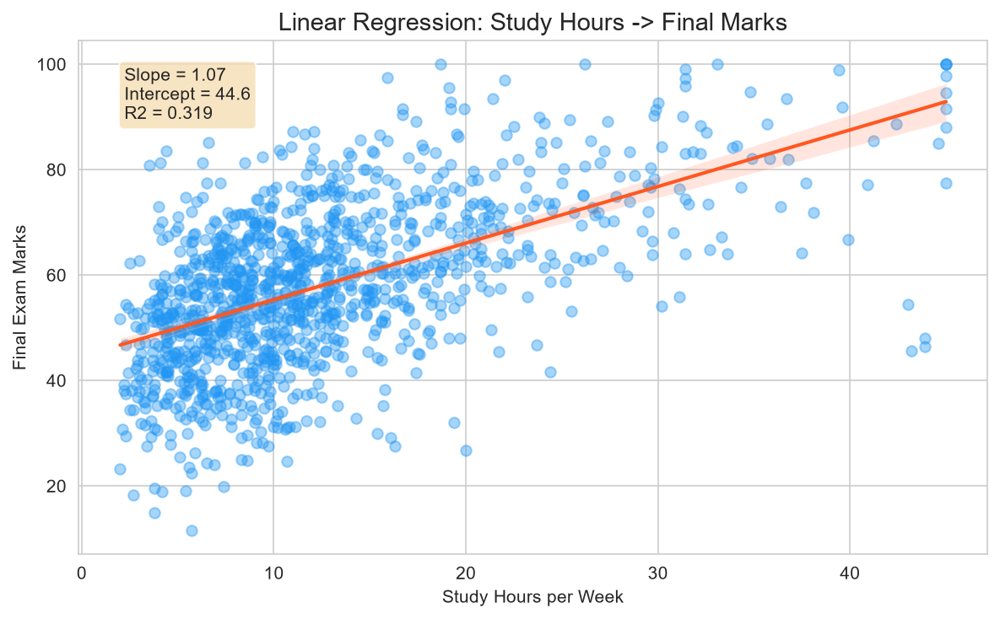
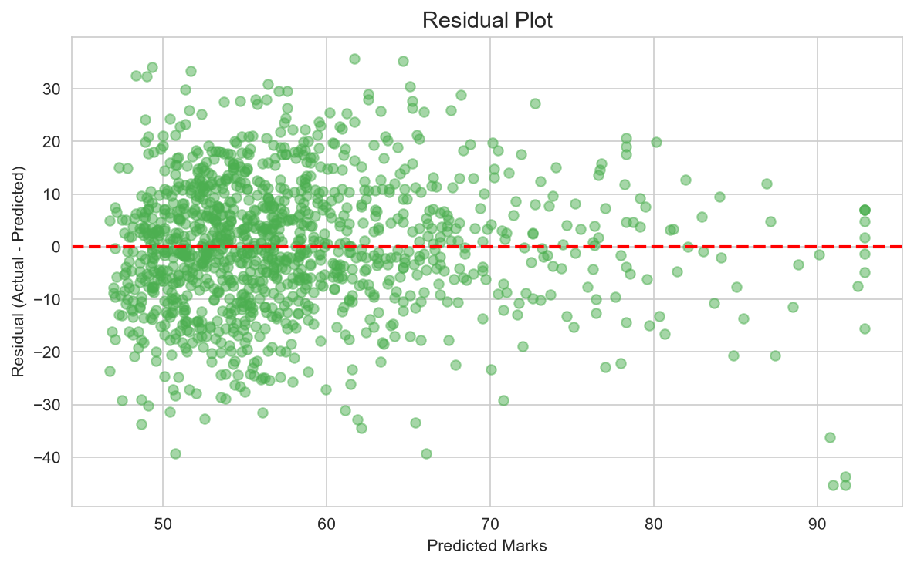

### Question 8 — Rolling Average & Uncertainty
- **Simple:** `simple_version/q08_rolling_avg_uncertainty.py` — 3-point rolling mean ± band
- **Advanced:** `full_version/q08_advanced_rolling_uncertainty.py` — SE, 95 % CI, error bars, window comparison
- **Key concepts:** `.rolling(n).mean()`, std-dev band vs confidence interval

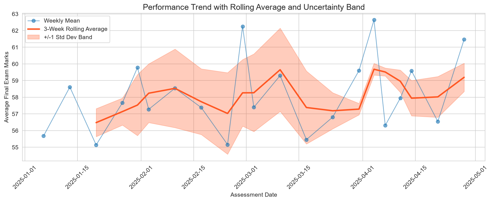

### Question 9 — PCA
- **Simple:** `simple_version/q09_pca_visualization.py` — 11 features → 2 PCs
- **Advanced:** `full_version/q09_advanced_pca.py` — scree plot, Kaiser rule, biplot, 3D view
- **Key concepts:** `StandardScaler` → `PCA(n_components=2)`, explained variance

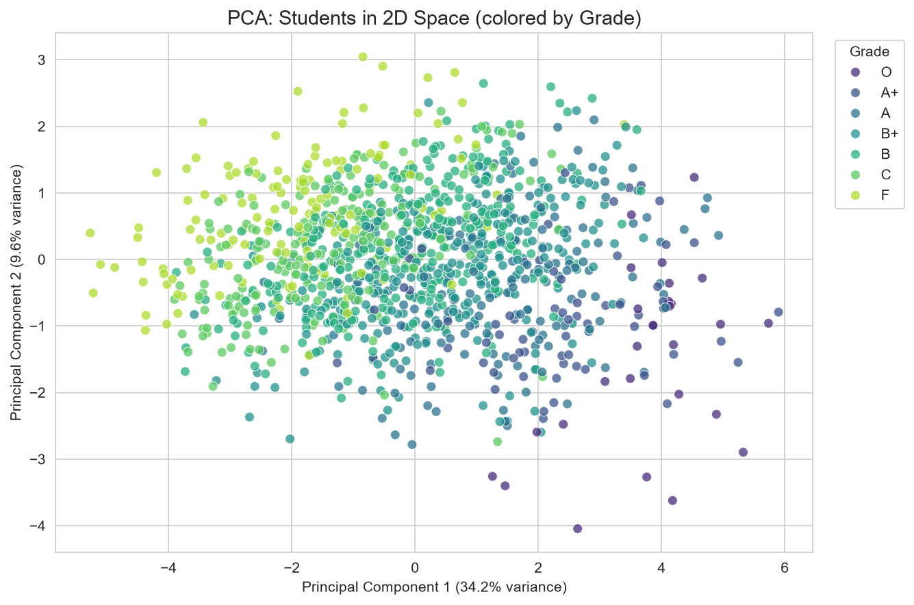
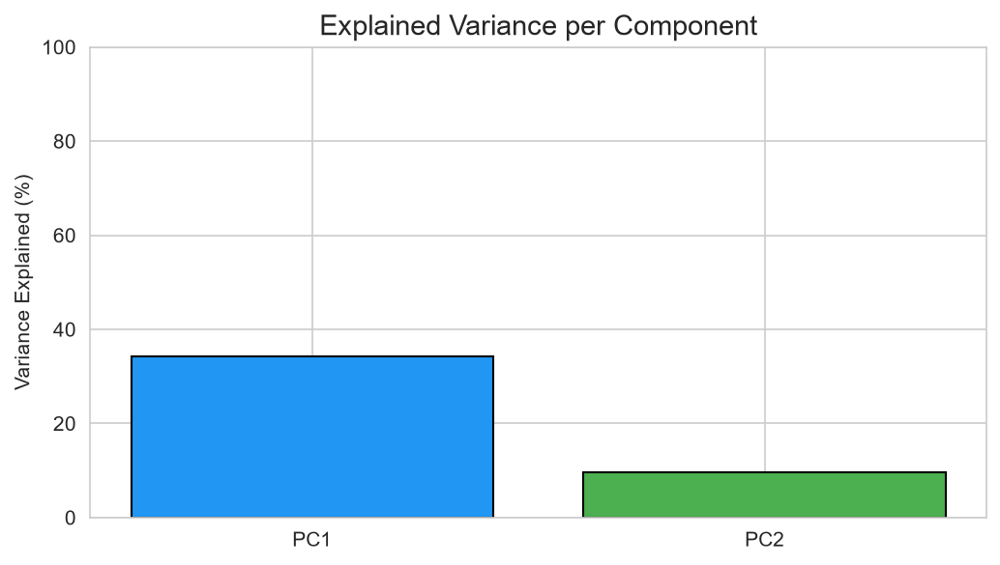

### Question 10 — t-SNE & UMAP
- **Simple:** `simple_version/q10_tsne_umap.py` — one run of each
- **Advanced:** `full_version/q10_advanced_tsne_umap.py` — perplexity 5/30/50 vs n_neighbors 5/15/50 + silhouette scores
- **Key concepts:** non-linear embeddings, cluster visuals, embedding pitfalls

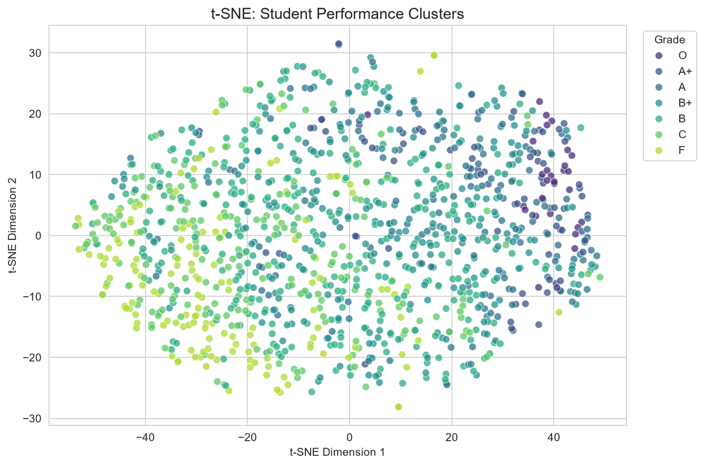
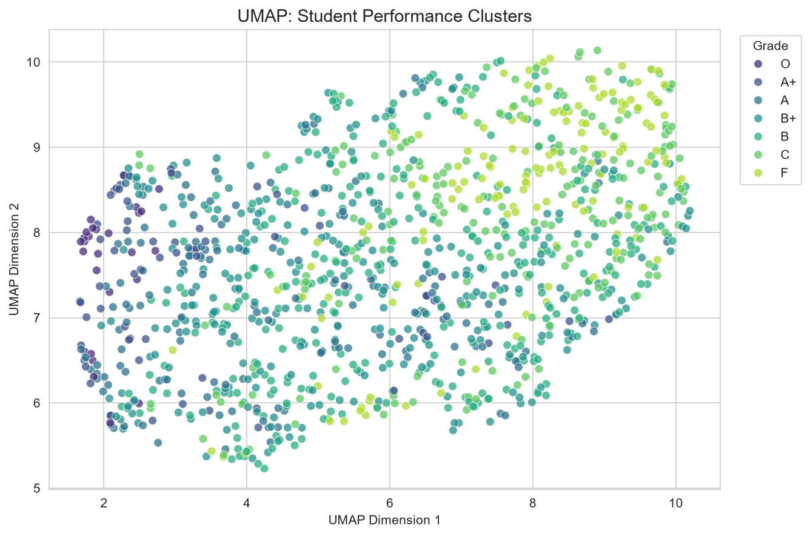

## 🔬 Simple vs Advanced Comparison

| Feature | Simple | Advanced |
|---------|--------|----------|
| Code length | 80–120 lines | 120–250 lines |
| Libraries | pandas, matplotlib, seaborn | + scipy, statsmodels, sklearn |
| Visualizations | one chart per figure | multi-panel layouts, annotations |
| Statistics | mean, std, skew | p-values, OLS diagnostics, Cook's distance |
| Interpretation | 2–3 printed sentences | detailed report with thresholds |

## 🎓 Study Guide for Practical Exam

### Quick revision checklist
- [ ] Load CSV → `df = pd.read_csv("path")`
- [ ] Bar chart → `plt.bar()` / `sns.barplot()`
- [ ] Histogram → `plt.hist()` / `sns.histplot()`
- [ ] Box plot → `sns.boxplot()` (quartiles + 1.5×IQR outliers)
- [ ] Line chart → `plt.plot(dates, values, marker="o")`
- [ ] Scatter → `plt.scatter()` / `sns.scatterplot(hue=...)`
- [ ] Heatmap → `sns.heatmap(corr, annot=True, cmap="coolwarm")`
- [ ] PCA → `StandardScaler().fit_transform` → `PCA(n_components=2).fit_transform`
- [ ] t-SNE → `TSNE(n_components=2, random_state=42, perplexity=30)`
- [ ] Regression → `LinearRegression().fit(X, y)` → `coef_`, `intercept_`, `score()`

### Key formulas
- **R²** = variance explained by the model (1 = perfect)
- **Skewness > 0** → right-skewed; **< 0** → left-skewed
- **IQR** = Q3 − Q1; outlier if `< Q1 − 1.5·IQR` or `> Q3 + 1.5·IQR`
- **Standard error** = std / √n ; **95 % CI** = mean ± 1.96·SE
- **PCA explained variance** = eigenvalue / Σ eigenvalues

### Five sentences that earn marks
1. *"Correlation does not imply causation."*
2. *"Bar charts must start at zero, otherwise differences are exaggerated."*
3. *"R² = 0.32 means study hours explain 32 % of the variation in marks."*
4. *"The std-dev band shows data spread; the confidence interval shows
   uncertainty of the mean."*
5. *"Distances between t-SNE clusters are not meaningful — it's for
   visualization only."*

## 🌐 Kaggle Notebook

Run everything online (no local install needed):
**[Open on Kaggle](https://www.kaggle.com/code/arulmariaagnes/data-v)**
— file: [`kaggle/data_visualization_complete_lab.ipynb`](kaggle/data_visualization_complete_lab.ipynb),
steps: [`kaggle/KAGGLE_INSTRUCTIONS.md`](kaggle/KAGGLE_INSTRUCTIONS.md)

## ⚠️ Important Notes

- The dataset is **SYNTHETIC** — clearly labelled fictional, never real data
- **Correlation ≠ causation** — large r values do not prove cause and effect
- **t-SNE/UMAP** distances and cluster sizes are not measurable quantities
- **PCA loses information** — always report the explained-variance percentages
- Legacy `exp*.py` files are the original lab attempts; the `q*.py` files are
  the structured final solutions

## 🛠️ Troubleshooting

| Problem | Fix |
|---|---|
| `FileNotFoundError: ...csv` | Run from the repo root, or check the path anchored at the top of each script |
| `ModuleNotFoundError: umap` | `pip install umap-learn` (Q10 has a built-in fallback) |
| `ModuleNotFoundError: statsmodels` | `pip install statsmodels` (advanced Q7) |
| No chart window appears | Savefig is default; uncomment `# plt.show()` in any script |
| `Chi-square`/future warnings from seaborn | Harmless; updates use `hue=` instead of bare `palette=` |
| Kaggle "CSV not found" | Attach the dataset as Input — see `kaggle/KAGGLE_INSTRUCTIONS.md` |

## 📜 License

[MIT License](LICENSE) © 2025 Arul Agnes

## 🙏 Credits

- [matplotlib](https://matplotlib.org), [seaborn](https://seaborn.pydata.org),
  [scikit-learn](https://scikit-learn.org), [statsmodels](https://www.statsmodels.org)
  documentation
- Cleveland & McGill (1984) — graphical perception foundations used in Q4
- Course instructors for the practical question set
